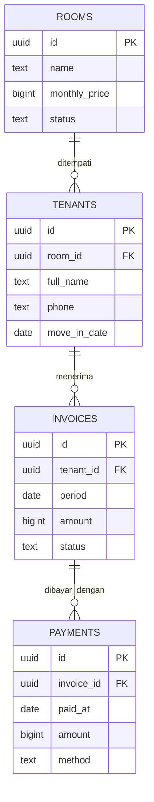

| **Nama**  | Lisa Anastasya                 |
| --------- | ------------------------------ |
| **NIM**   | 12030124130086                 |
| **Kelas** | Pengkodean dan Pemrograman (E) |

# KostPay

KostPay merupakan sistem pembayaran kos berbasis website yang dirancang untuk membantu pengelola kos dalam mengelola data kamar, penghuni, tagihan, dan pembayaran secara lebih terstruktur dan terintegrasi. Sistem ini menyediakan informasi mengenai ketersediaan kamar, data penghuni, status tagihan, serta riwayat pembayaran sehingga proses administrasi kos dapat dilakukan dengan lebih mudah.

KostPay mengintegrasikan empat entitas utama, yaitu Kamar, Penghuni, Tagihan, dan Pembayaran. Setiap entitas saling berhubungan untuk mendukung pengelolaan administrasi dan pemantauan pembayaran kos.

Demo Website: https://grethaniahl-cell.github.io/kostpay-pembayaran-kos-sistem/

1. Dashboard Terintegrasi

Dashboard menyajikan ringkasan informasi utama terkait operasional pembayaran kos. Fitur ini membantu pengguna memahami kondisi pengelolaan kos tanpa harus membuka setiap bagian secara terpisah. Informasi yang ditampilkan terintegrasi dengan data kamar, penghuni, tagihan, dan pembayaran sesuai dengan informasi yang tersedia pada sistem.

2. Manajemen Kamar

Fitur kamar digunakan untuk memantau kondisi dan ketersediaan setiap kamar kos. Sistem menyediakan tiga status kamar:

- Tersedia: kamar belum ditempati dan dapat digunakan oleh calon penghuni.
- Terisi: kamar sedang ditempati oleh penghuni.
- Diperbaiki: kamar sedang dalam proses perbaikan sehingga tidak tersedia untuk ditempati.

Status kamar disesuaikan dengan informasi penghuni dan kondisi kamar yang tercatat dalam sistem. Dengan demikian, pengelola dapat lebih mudah mengidentifikasi kamar yang dapat digunakan maupun kamar yang sedang ditempati atau diperbaiki.

3. Database Penghuni

Fitur database penghuni digunakan untuk menyimpan dan mengelola informasi penghuni kos. Data penghuni terhubung dengan informasi kamar sehingga pengelola dapat mengetahui siapa yang menempati kamar tertentu. Keterkaitan ini juga mendukung pengelolaan tagihan dan pencatatan pembayaran berdasarkan penghuni atau kamar yang bersangkutan.

4. Manajemen Tagihan

Fitur tagihan membantu pengelola mencatat dan memantau kewajiban pembayaran sewa kos pada setiap kamar.

Informasi yang dikelola meliputi:

- Kamar yang memiliki tagihan.
- Nominal tagihan.
- Tanggal jatuh tempo.
- Status pembayaran.

Fitur ini membantu pengelola mengidentifikasi tagihan yang telah dibayar maupun yang masih perlu ditindaklanjuti. Informasi jatuh tempo juga mendukung pemantauan kewajiban pembayaran secara lebih teratur.

5. Pencatatan Pembayaran

Fitur pembayaran digunakan untuk mencatat pembayaran penghuni yang telah menyelesaikan kewajibannya. Pembayaran yang telah lunas dapat ditampilkan sebagai informasi transaksi yang sudah diselesaikan. Data tersebut membantu pengelola memantau penyelesaian tagihan dan menelusuri catatan pembayaran yang tersedia dalam sistem.

## Menjalankan frontend

Buka `frontend/index.html` langsung di browser. Tidak memerlukan build tool atau library eksternal. Agar semua pengunjung langsung memakai project yang sama, isi `projectUrl` dan `publishableKey` sekali di `frontend/config.js` sebelum membagikan atau memublikasikan folder `frontend`. Pengaturan yang sudah tersimpan di browser tertentu tetap menjadi pilihan browser tersebut; tombol **Gunakan konfigurasi bawaan** menghapus pilihan lokal dan kembali ke nilai `config.js`.

## Menyiapkan database

1. Buat project di Supabase.
2. Buka **SQL Editor** pada dashboard Supabase.
3. Jalankan isi `database/schema.sql`.
4. Salin Project URL dan Publishable Key dari pengaturan API project ke KostPay.

Jika tabel sudah pernah dibuat, jalankan blok `sync_room_status_from_tenants` beserta `create trigger` dan `update public.rooms` di `database/schema.sql` untuk mengaktifkan sinkronisasi status tanpa menjalankan ulang seed kamar.

Frontend berkomunikasi langsung dengan Supabase REST API. Kebijakan SQL saat ini memberi akses CRUD kepada role `anon` supaya aplikasi bisa dipakai tanpa login. Ini cocok untuk tugas/demo; jangan gunakan kebijakan terbuka ini untuk menyimpan data penghuni sungguhan di project produksi. Publishable key aman untuk frontend, tetapi jangan pernah memakai `service_role` key.

## Backend opsional

`backend/app.js` adalah proxy REST opsional yang memakai modul bawaan Node.js (Node 18+), tanpa package.json atau dependensi npm. Jalankan dengan `node backend/app.js`; frontend yang dibuka langsung tetap memakai Supabase secara langsung dan tidak bergantung pada backend ini. Endpoint pemeriksaan tersedia di `http://localhost:3001/api/health`.

Untuk memakai proxy, request ke `/api/rooms`, `/api/tenants`, `/api/invoices`, atau `/api/payments` dengan header `x-supabase-url` berisi Project URL dan `apikey` berisi Publishable Key. Query string dan metode GET/POST/PATCH/DELETE diteruskan ke Supabase.

## Relasi ERD

- Satu kamar dapat ditempati banyak penghuni sepanjang waktu; setiap penghuni terhubung ke satu kamar.
- Satu penghuni memiliki banyak tagihan.
- Satu tagihan dapat memiliki banyak pembayaran.
- Status tagihan otomatis menjadi lunas saat total pembayaran mencapai jumlah tagihan.

